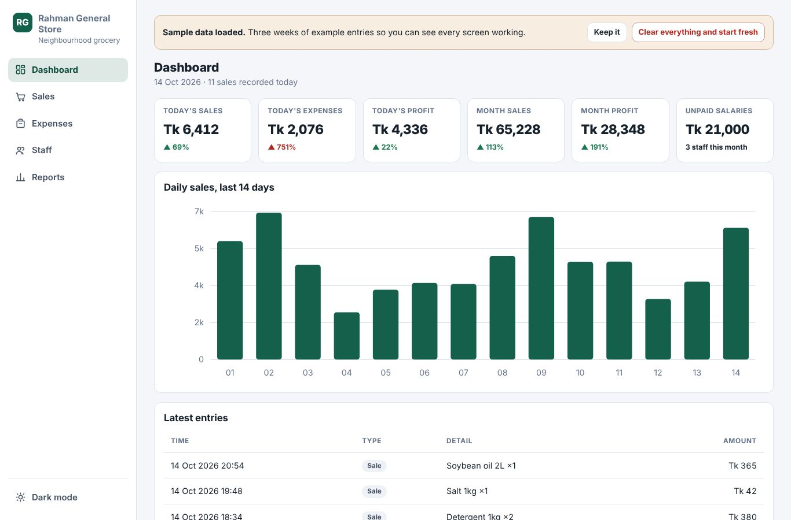

# Shop Ledger

A complete shop management app in **one HTML file**. No build step, no server, no install, no account. Open `index.html` in a browser and it works, offline.

**[Live demo](https://webhosting484-create.github.io/shop-ledger/)**

## What it does

| Tab | What it holds |
|---|---|
| **Dashboard** | Today's sales, expenses and profit; this month's sales and profit; unpaid salaries. Each tile compares against yesterday or last month. A 14-day sales chart and the latest entries. |
| **Sales** | Item (suggested from past items), quantity, unit price, live total, cash / card / due. Pick any day; the footer total follows. |
| **Expenses** | Grouped by category, subtotal per category, grand total for the month. |
| **Staff** | Name, role, monthly salary, phone, joining date. One click records a salary payment and the unpaid figure drops. Full payment history. |
| **Reports** | Month picker, totals, a day-by-day table with best and worst day marked, expenses by category, CSV export, JSON backup and restore. |
| **Settings** | Shop name, currency symbol, and the expense-category and staff-role lists. Rename one and every old entry follows. A category still in use cannot be removed. |

## How the numbers work

- Profit = sales − expenses − salaries paid, defined the same way on every screen.
- Money is stored as whole-unit integers. No floating point arithmetic on amounts.
- Totals are recomputed from the data on every render, never cached in a variable.
- Deleting asks first and can be undone for five seconds.

## Data

Everything lives in one `localStorage` key on the device. Nothing is sent anywhere — there is no server. Use **Back up JSON** before clearing browser data, and **Restore** to move to another machine.

On first run the app seeds three weeks of sample data so every screen and chart is full. The banner at the top clears it.

## Making it yours

Open `index.html` and edit the five lines at the top of `prompt.txt` to regenerate, or just use the **Settings** tab in the running app to change the shop name, currency and lists.

The app was built from `prompt.txt` with Claude Code. Set `UI LANGUAGE` in that prompt to any language and the whole interface, month names included, comes out in it.

## Tested

- No console errors or warnings on load, on resize, or after exercising every control
- No horizontal scroll from 320px to 2560px
- Body text contrast above 4.5:1 in both light and dark themes
- Arithmetic verified: adding a sale moves four separate figures by exactly its amount; the report footer equals the sum of its own rows; delete-then-undo returns every figure
- Reports prints on A4 as a clean statement

## Licence

MIT
